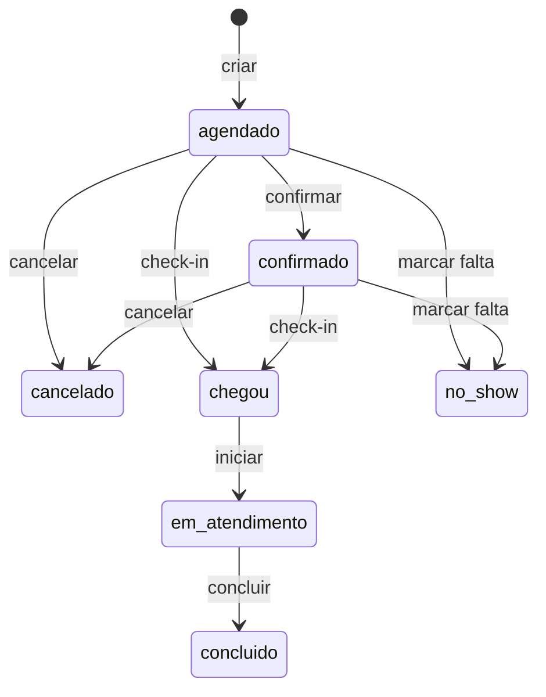
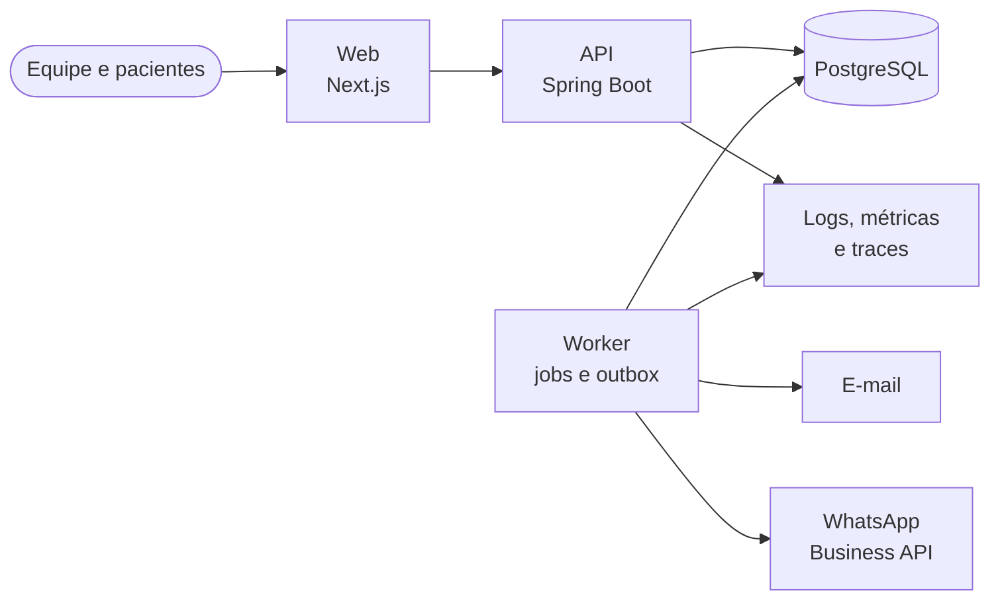
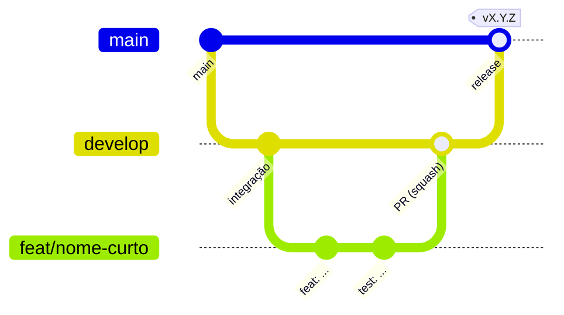

<a id="top"></a>

<div align="center">

<picture>
  <source media="(prefers-color-scheme: dark)" srcset="docs/assets/clinicos-logo-dark.svg">
  
</picture>

**Gestão para clínicas de estética e odontologia: agenda que não duplica horário, confirmações por e-mail e WhatsApp, permissões por papel e indicadores com definição transparente.**

[](#roadmap)

[](https://openjdk.org/)
[](https://spring.io/projects/spring-boot)
[](https://www.postgresql.org/)
[](https://nextjs.org/)
[](https://www.typescriptlang.org/)
[](https://tailwindcss.com/)
[](https://www.docker.com/)
[](LICENSE)

[Sobre](#sobre) ·
[Funcionalidades](#funcionalidades-do-mvp) ·
[Arquitetura](#arquitetura) ·
[Estrutura](#estrutura-do-projeto) ·
[Roadmap](#roadmap) ·
[Contribuindo](#contribuindo)

</div>

---

## Sumário

- [Sobre](#sobre)
- [Funcionalidades do MVP](#funcionalidades-do-mvp)
- [Como a agenda evita conflitos](#como-a-agenda-evita-conflitos)
- [Arquitetura](#arquitetura)
- [Tecnologias](#tecnologias)
- [Estrutura do projeto](#estrutura-do-projeto)
- [Roadmap](#roadmap)
- [Segurança e privacidade](#segurança-e-privacidade)
- [Acessibilidade](#acessibilidade)
- [Contribuindo](#contribuindo)
- [Identidade visual](#identidade-visual)
- [Licença](#licença)

## Sobre

Clínicas de estética e de odontologia perdem receita com faltas, horários ociosos e retrabalho de confirmação, e muitas ainda operam com planilhas, WhatsApp manual e agendas isoladas. O **ClinicOS** reúne agenda, pacientes, equipe e comunicação em um único lugar confiável.

A primeira entrega (MVP) é um núcleo operacional enxuto: agenda sem double-booking, confirmação e lembretes, permissões por papel e indicadores determinísticos. Inteligência artificial, CRM, finanças, estoque e prontuário ficam para fases posteriores, e o sistema inteiro funciona sem IA.

> [!NOTE]
> O projeto está em fase de planejamento e fundação. O PRD está consolidado e o código começa pelo Sprint 0 (esqueleto do repositório, ambiente local, CI e provas de conceito). ClinicOS é um nome provisório.

<p align="right"><a href="#top">voltar ao topo</a></p>

## Funcionalidades do MVP

| Área | O que entrega |
|---|---|
| **Identidade e acesso** | Login, MFA para perfis privilegiados, convites com expiração, revogação de sessão e controle de acesso por papel avaliado no servidor |
| **Clínicas e unidades** | Vários tenants isolados, unidades com fuso horário próprio e módulos ativáveis por tenant |
| **Pacientes** | Cadastro mínimo, busca segura, consentimentos e preferências por canal, alerta de duplicidade e merge auditado |
| **Equipe e serviços** | Profissionais, serviços com duração e buffers, jornadas, bloqueios, férias e exceções |
| **Agenda** | Cálculo de horários livres, criar, remarcar, cancelar, confirmar e check-in, com histórico de status imutável |
| **Notificações** | Confirmação e lembretes por e-mail e WhatsApp, templates versionados, opt-out, retry e log de entrega |
| **Painel "Hoje"** | Consultas do dia, pendências de confirmação, cancelamentos, faltas e ocupação, com a definição de cada número ao lado |
| **Auditoria e plataforma** | Trilha append-only e console de plataforma com acesso de suporte temporário e registrado |

<p align="right"><a href="#top">voltar ao topo</a></p>

## Como a agenda evita conflitos



Qualquer transição fora do diagrama é recusada com erro `409`. A proteção contra dois agendamentos no mesmo horário não depende só do código da aplicação:

1. **Defesa no banco:** uma restrição de exclusão do PostgreSQL impede intervalos sobrepostos do mesmo profissional entre consultas ativas.
2. **Transação curta:** a API valida as regras, grava e confirma; se a restrição falhar, responde `409` com horários alternativos.
3. **Idempotência:** toda criação aceita uma chave de idempotência, e repetir a chamada devolve o mesmo resultado.
4. **Eventos confiáveis:** o evento de domínio é gravado na mesma transação (outbox), e o envio de mensagens acontece só depois do commit.
5. **Teste de corrida no CI:** 50 requisições simultâneas ao mesmo horário, repetidas 1.000 vezes, devem produzir exatamente um sucesso.

<p align="right"><a href="#top">voltar ao topo</a></p>

## Arquitetura

Monolito modular, uma única aplicação implantada em dois perfis: `api` (HTTP) e `worker` (jobs e outbox).



- Os módulos (`identity`, `audit`, `tenancy`, `patients`, `staffservices`, `scheduling`, `notifications`, `analytics`, `platformadmin`, `integrations`) têm limites verificados no build, e dependências só apontam para baixo.
- Cada módulo é dono das suas tabelas; módulos se comunicam por interface pública e por eventos de domínio.
- O tenant vem sempre da sessão, nunca de parâmetro, caminho ou corpo da requisição.
- Fila de jobs e outbox ficam no próprio PostgreSQL, sem Redis nem RabbitMQ no MVP.
- Provedores externos (WhatsApp, e-mail, armazenamento) ficam atrás de adaptadores.

<p align="right"><a href="#top">voltar ao topo</a></p>

## Tecnologias

| Camada | Tecnologias |
|---|---|
| **Back-end** | Java 25, Spring Boot 4, Spring Modulith, Spring Data JPA, Spring Security, Flyway, springdoc (OpenAPI) |
| **Banco de dados** | PostgreSQL, com restrição de exclusão (`btree_gist`) e Row-Level Security |
| **Front-end** | Next.js (App Router), React, TypeScript, Tailwind CSS, shadcn/ui, TanStack Query, React Hook Form, Zod, next-intl |
| **API** | REST + JSON em `/api/v1`, erros em Problem Details (RFC 9457), paginação por cursor e `Idempotency-Key` |
| **Testes** | JUnit 5, Testcontainers, Vitest, Testing Library, Playwright com axe-core, k6 |
| **Observabilidade** | OpenTelemetry, Micrometer, logs JSON com redação de dados pessoais, Sentry |
| **Ferramentas** | Gradle (Kotlin DSL), pnpm e Turborepo, Docker Compose, GitHub Actions |

> [!NOTE]
> Esta é a stack prevista no PRD. Itens ainda em decisão, como a biblioteca de calendário e os provedores de WhatsApp e de hospedagem, serão registrados como ADRs em `docs/adr/`.

<p align="right"><a href="#top">voltar ao topo</a></p>

## Estrutura do projeto

Estrutura prevista; as pastas são criadas conforme as etapas do Sprint 0.

```
clinicos/
├── apps/web/            Next.js (app interno e página pública de agendamento)
├── packages/
│   ├── api-client/      Cliente TypeScript gerado a partir do OpenAPI
│   ├── tokens/          Paleta, variáveis CSS e tema
│   ├── ui/              Componentes de interface
│   └── config/          tsconfig, ESLint e Prettier compartilhados
├── backend/             Spring Boot, monolito modular (Gradle)
├── contracts/           Snapshot versionado do OpenAPI
├── infra/               Docker Compose e implantação
├── tools/seed/          Gerador de dados sintéticos
├── docs/                PRD, ADRs, runbooks e segurança
└── .github/             Workflows de CI e template de PR
```

<p align="right"><a href="#top">voltar ao topo</a></p>

## Roadmap

As durações abaixo são estimativas de baixa confiança, a calibrar com equipe e orçamento definidos.

- [x] PRD consolidado, com requisitos, regras de agenda, modelo de dados e decisões de arquitetura
- [x] Fluxo de branches, convenções de commit e template de PR
- [ ] **Sprint 0:** esqueleto do repositório, ambiente local, CI e provas de conceito (exclusão de conflito, RLS com pool de conexões e outbox com worker)
- [ ] **R1, MVP:** identidade, tenancy, pacientes, equipe e serviços, agenda, notificações, painel "Hoje" e auditoria
- [ ] **R1.5:** agendamento público e portal do paciente
- [ ] **R2:** lista de espera, recuperação de vagas, recursos (salas e equipamentos) e tarefas
- [ ] **R3:** CRM, orçamentos e módulo da especialidade piloto
- [ ] **R4:** finanças e estoque
- [ ] **R5:** inteligência operacional (previsões e copiloto de leitura), só com histórico suficiente

<p align="right"><a href="#top">voltar ao topo</a></p>

## Segurança e privacidade

Dados de saúde são dados pessoais sensíveis, e até a informação de quem foi atendido e quando pode revelar condição de saúde.

- Isolamento entre tenants com filtro na aplicação e Row-Level Security, com teste de acesso cruzado obrigatório em todo endpoint.
- Autorização por papel e escopo avaliada no servidor, sessão por cookie HttpOnly, senhas com Argon2id e MFA para perfis privilegiados.
- Trilha de auditoria append-only; acesso de suporte da plataforma só com concessão temporária, justificativa e registro visível à clínica.
- Nenhum dado pessoal em logs, traces, analytics ou relatórios de erro, com teste automatizado de vazamento.
- Somente dados sintéticos em desenvolvimento, testes e demonstrações.

> [!IMPORTANT]
> Este projeto não declara conformidade com a LGPD. Antes de tratar dados reais, é necessário parecer jurídico sobre bases legais, papéis e retenção, além de plano de resposta a incidentes, teste de restauração e teste de invasão.

<p align="right"><a href="#top">voltar ao topo</a></p>

## Acessibilidade

A meta é **WCAG 2.2 AA** nos fluxos-chave (login, agenda, criar consulta e portal), com navegação por teclado, foco visível e nenhuma informação transmitida só por cor. O desenho é desktop-first para recepção e gestão, e funcional em telas de 360 px para profissionais e pacientes, com tema claro e escuro.

<p align="right"><a href="#top">voltar ao topo</a></p>

## Contribuindo

O fluxo tem duas branches de longa duração: a `develop` integra o trabalho e a `main` guarda o código estável. Nada vai direto para nenhuma das duas.



1. Parta sempre da `develop` atualizada e crie uma branch com prefixo do tipo: `feat/`, `fix/`, `chore/`, `docs/`, `refactor/`, `test/`.
2. Escreva os commits em português, no padrão [Conventional Commits](https://www.conventionalcommits.org/pt-br/v1.0.0/) e no imperativo, por exemplo `feat(scheduling): adiciona cálculo de slots livres`.
3. Abra a PR para a `develop` preenchendo o [template](.github/pull_request_template.md). O merge é por *squash* e implanta em staging.
4. A `main` recebe apenas a PR de release, vinda da `develop`. Produção sai por tag SemVer (`vX.Y.Z`) com aprovação.

Os detalhes estão em [CONTRIBUTING.md](CONTRIBUTING.md).

<p align="right"><a href="#top">voltar ao topo</a></p>

## Identidade visual

<div align="center">


&nbsp;&nbsp;


</div>

| Cor | Hex | Uso |
|---|---|---|
|  | `#101827` | Primary: marca, botões e texto de destaque |
|  | `#16B8A6` | Accent: ações principais (texto Primary sobre Accent, nunca branco) |
|  | `#0F766E` | `accent-fg`: texto e links em teal com contraste AA |
|  | `#E6F5F2` | Accent Soft: fundos suaves |
|  | `#F5F7FA` | Background |
|  | `#E3E8EF` | Border |
|  | `#263243` | Text |
|  | `#5C6B80` | `muted-on-bg`: texto secundário sobre o fundo |

Os estados (sucesso, alerta, erro e informação) usam as cores originais só em ícones, bordas e fundos, e as variantes `-fg` para texto, de modo a manter o contraste mínimo.

<p align="right"><a href="#top">voltar ao topo</a></p>

## Licença

Distribuído sob a licença MIT. Veja o arquivo [`LICENSE`](LICENSE).

<p align="right"><a href="#top">voltar ao topo</a></p>
